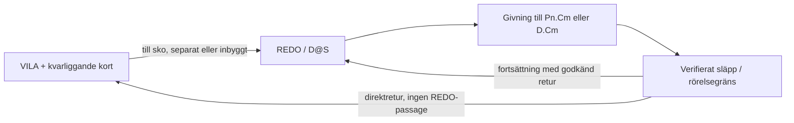

# Dealeridentiteter och pipelines

Identitetsgrunden kontrollerades 2026-11-08; Pamelas bank och systemkartan nedan kontrollerades 2026-11-10 av HUVUDAGENT-3 med tre avgränsade Astra-granskningar. Identiteterna bygger på Jakobs uttryckliga identifiering, separata projekt-/dealer-ID:n och filhashar. Utseende eller gemensamt lagringskonto identifierar inte en dealer.

| Lokal identitet | Scoutgaming-ID | Spår | Bevis |
|---|---|---|---|
| Göran · Scout Main | `goran` | Ordinarie filmade dealerklipp | Admin: `Göran · vila_andning_01 · 9492f43d`, klipp-ID `fbb08d0c-856c-52ca-a18b-1865866aa64f`. Lokal `goran_vila_grundloop.mp4` har samma hashprefix. Jakobs första bild identifierar dealern. |
| Blankurius · Scout Main | `blankurius` | Snabbstudion, enligt Jakob Utökad | Admin: `Blankurius · vila_andning_01 · 9fe76a9f`, klipp-ID `54c3ff6f-78ae-555e-8fdf-e7309c913d71`. |
| Göran · blackjack-studio | Inget verifierat | Separat experimentell Runway-pipeline | Jakobs andra bild och granskat Runway-original `893e4e04-f48f-4bf7-8e38-c416de50b033`. 1920 × 1080, 30 fps, 90 rutor, grön bakgrund. |
| Pamela · Dealerlab | Inget registrerat | `pamela-pilot`, egen V5-identitetsgrund och kalibrering | `references/dealers.json` samt de valda rå-/granskningsfilernas SHA-256. Alias `pamela` i äldre försöksplaner måste bindas explicit till samma identitet. |

`references/dealers.json` binder klassificering till exakt lokal SHA-256. Ändrade filer blir oklassificerade tills de granskats igen. Övriga Runway-filer tilldelas inte identitet bara för att de är nya eller har liknande promptnamn.

## Uppdaterad identitets- och provstatus

Registret `references/dealers.json` är kontrollerat mot sex lokala projektmanifest i `local-studio/blackjack-studio`, i både `typed-preview` och `creator`. Inget av dessa verifierar en andra Pamela. Gemensam Pamela-identitetsgrund och återanvändning av kropp/kalibrering är därför okända. Projektet Naturbord · Liv har en deklarerad ankarkedja som inte stämmer med den valda bildens uppmätta hash; automatisk identitetskoppling är spärrad. Göran-projektets manifestrevisioner 103 och 107 hålls uttryckligen isär.

P1-piloten använder `pamela-pilot` / `snyggare-dealer` / `pamela-workspace-v1`. V2-kandidaten bevarar alla v1-tillgångar och ger två explicita returplaner utan REDO efter sista släppet. Faktiska klipp, source-frame-mappning, avvisade försök och QA-beslut finns via `references/pamela-direct-return-review.json`; kortsidprovet via `references/pamela-card-side-review.json`. Inget av proven aktiverar en produktionsbank.
## Blankurius ursprung

Jakob uppger att Blankurius kom från `https://www.scoutgaming.tech/studio/snabb`, med utökat klippalternativ och en egen bild på vit bakgrund. Detta är **användaruppgift**, inte verifierad jobbproveniens. Jobb-ID, ursprungsbildens hash och eventuell omarbetning till keystonebild saknas ännu.

WebView bekräftade sidan och stegen Foto → Namn och röst → Omfattning → Kör → Granska → Sätt vid bord. Referenskoden `C:/Users/jakem/dev/scoutgaming/apps/studio/lib/snabb/client.mjs` använder `/admin-app/api/jobs/snabb` och kontraktets `grund`/`utokad`. Koden skiljer mellan en ny kedja och påfyllning av en klar Grund-dealer till Utökad. Det styrker att vägen finns, men avgör inte vilket jobb som skapade Blankurius.

En vit bakgrund är inte en kvalitetsstämpel. Keystonegranskningen behöver senare pröva identitet, kamera/perspektiv, händer och anatomi, ljus, silhuett och geometri mot målbilden. Ingen förbättring eller omarbetning har gjorts nu.

## Alternativa system

- **Äldre 3D-scenreferens:** Three.js-scen, panorama och videoplan från `extra/insperationsmall-alternativ`. Inte verifierad som riggad avatar. Se ALTERNATIV-3D.md.
- **Alternativ helkroppspipeline:** den större helkroppsfiguren i Jakobs andra bild. Samma projekt som den äldre 3D-scenreferensen är nu verifierat genom projekt-ID, ankare, panorama och nickfilm. 19 källfilmer finns i blackjack-studio revision 103. Koppling till Scoutgamings kortlogik är inte verifierad. Se `references/alternative-fullbody.json`.
- **Kevin/Emil:** separat referensgren och rörelsedata. Namnlikhet gör inte klipp, mått eller tidsaxlar utbytbara.

De alternativa referenserna ligger under studions tredje flik med separata källscheman. Ingen databaspost eller Blob-fil har flyttats eller ändrats. Gemensamt Blob-lager innebär inte i sig delad logik; någon fullständig granskning av produktionskopplingarna har inte utförts.

## GPT-underlaget

Paketets roll, innehåll och läsgränser finns i [studiokartan](KARTA.md#vad-gpt-mappen-är).

## Gemensamt filmkontrakt före Scout-integration

**Aktuellt kravunderlag, 2026-11-10; v2-kandidat och pilotverktyg finns, generell acceptans återstår.** Skapa en sammanhängande lokal bank där filmval, nodkarta och QA utgår från samma kontraktsrevision. Kopplingen till Scout `main` kommer senare. Första målserien är **P1–P7 med två kort vardera och D med tre kort: 17 givmål**. Det är inte ett krav på exakt 17 filmfiler eller en regel om maximalt antal blackjackkort. Senare utökning följer Scouts giv-, hit-, double-, split-, dealer- och reveal-fall.

Jakobs två ytterligare krav gäller genom hela planen: kortsidan ska kunna identifieras säkert, exempelvis med blå framsidesmarkör och gul baksidesmarkör; och en avslutande giv ska kunna gå **direkt från giv-/släppläget till VILA utan att först återvända till REDO/skon**. Författade kortvändningar bevaras som framtida alternativ. De behöver inte byggas in i varje originalgivning.

### En auktoritet, flera läsvyer

Vidareutveckla `references/pamela-motion-contract.json` och dess befintliga kärna till en generell, versionerad leveransrot med hashbundna delmanifest. Bind original, valda bearbetningar, spår, masker, material, kalibrering och acceptans där. Nodkartan, biblioteket, granskningssidan och exporten blir härledda vyer. Befintliga original och försöksjournaler bevaras. En gemensam kontraktsmodell behöver inte vara en enda stor JSON-fil.

Jakobs nodträd är semantisk grund: fack, rörelser, poser och koordinatkonventioner. Originalstandarden säger själv att dess katalog är ett daterat Main-utdrag, inte runtimekonfiguration (`gpt-underlag/5/Scoutgaming-Pamela-standard-v0.1.md:5–13`). `references/schemes.json` är fem separata referensscheman, inte Pamelas körplan. Vid senare integration återanvänds Scouts `packages/presentation/contracts/engine-signals.json` och `.mjs`; skapa ingen ytterligare handskriven motoröversättning.

### Vad som redan finns och vad som saknas

| Del | Verifierat 2026-11-10 | Kvar till den beställda banken |
|---|---|---|
| P1–P7, C1/C2 | 14 råfilmer och 14 valda granskningsfilmer; 28/28 SHA matchar. Kandidaterna är 360 rutor, 1762×1174, 30 fps. | Gemensam layout, stabilt tryck, full kontakt-/skarvacceptans och styrbar kortstate. |
| D.C1–D.C3 | Inga valda Pamela-givfilmer i den kontrollerade banken. | Egen dealergiv, dolt/öppet tillstånd, tredje giv samt separat reveal där motorhändelsen kräver det. |
| VILA och sko | Tre viloklipp och två bryggor i äldre kontrakt; senare separat VILA-kedja finns. | Bind senaste resultat, acceptera faktiska skarvar och behåll bordskorten under retur. |
| Direkt giv → VILA | Fem avslutade P1-returförsök; 0/2 accepterade vägar. Äldre B-prov går direkt efter sista släppet men matchar inte ursprunglig VILA-keystone. Två canonical C1-försök har återkontakt; canonical C2 är aldrig inskickad. | Godkänd kontakt, canonical VILA-bindning och rörelse-/texturskarv utan dold stillhållning. |
| Kontrakt | 24 assets, 19 klipp, samtliga `raw-reference`/`pending`, 0 `edgeGates`. | Senaste bank/kedja, nya ändpunkter, dealerhand, spår, acceptans och export. |
| Nodkarta | 205 grafobjekt/281 relationer; 36 katalogposter. `mainConnected=false`, `importedIntoAtlas=false`. | Härledning från vald kontraktsrevision. Grafantal är inte antal färdiga rörelser. |

**Kandidattäckning för de 17 givmålen: 14/17 = 82,4 %.** Detta räknar kandidatfilm per mål, inte direktreturer, reveals, kvalitet eller total projektfärdiggrad. Produktionsacceptans för den valda banken är 0 %. Den fasta 4 319-rutorskedjan visar en hel rundas retur med 14 kort, inte valfri retur efter N.

Källor: `references/pamela-motion-contract.json:299–317,426–789,876`, `references/pamela-two-sided-bank.json:3–8`, `references/pamela-idle-chain-review.json:3–12`; bankens `runs/20261110-pamela-mask-bank/take-01/evidence.json` har SHA `ed63d72517802affc241445070c3242c5440d0ab2122d6f55a36b22f372967dc`. Kedjans film har SHA `9b9f9d84e75ff537e4dadae6ded9755fce38b4aa973f20e76ce32336d02d8dcf` och eget bildplan 1764×1174/30 fps. Ingen ny total mognadsprocent har mätts; externa granskarens cirka 35 % är en osäker skattning på äldre versioner.

### Namn, kortplatser och koordinater

[Namn och rörelsesträngar](NAMN-OCH-RORELSESTRANGAR.md) är norm för nya etiketter: C är primärt och K endast schemaidentifierat alias. Dealerhandens L/R/BOTH/UNKNOWN är separat från spelarhandens `handId`/`layoutHandId`. REDO och REVEAL skrivs fullt; ett ensamt R får inte blanda pose, handling och höger hand. Befintliga original-ID:n och hashbundna V2-kontrakt behålls tills en uttrycklig adapter finns.

| Läsbar etikett | Betydelse och strukturerade data |
|---|---|
| `P1.C2` | Spelarplats 1, kort 2 i den aktuella handen. V2:s `P1.K2` och äldre `C2-P1` kräver varsitt identifierat källschema; byt inte namn på original. |
| `P1.C1` med separat hand-/grenbindning | Första kortet i en bestämd spelhand. Split anges med motorns hand-ID och layoutbindning, inte genom att blanda dealerhand och kortordinal. |
| `D.C1`–`D.C3` | Dealerns kort i aktuell grundserie. Öppet/dolt/reveal anges separat; reveal skapar inget nytt kort. |
| `S` | Sko som rekvisita/kontaktpunkt, inte spelarplats. |
| `D@S` / eventuellt `DS` | Läsbar poseetikett för dealer vid sko. Den motsvarar REDO först när hand-/kroppsposen verifierats. |

Plats P1–P7 motsvarar Scout `box0`–`box6`. Kortordinal i handen, rörelsevariantens nummer och motorns `shoeDraw` är olika axlar. `shoeDraw` och kortinstansens identitet följer kortet även när split ändrar handen. **K5 saknar fast definition i de granskade originaldokumenten.** Jakobs exempel specificeras därför som direktretur från en identifierad giv-/släppändpunkt med mottagare, kortinstans och källruta; det tolkas inte automatiskt som plats P5 eller ett femte handkort.

Varje landning får en gemensamt vald bordslayout och egen källkalibrering: koordinatrum, pixelmått, origo, axelriktning, enhet, fyra ordnade kortlokala hörn, UV-riktning, vinkelkonvention och transform till scen/export. Centrum och vinkel räcker inte vid perspektiv eller böjning. Spår anges per källruta/presenterad tid med synliga/ockluderade hörn och hand-/sko-/bordsmasker. 1762- och 1764-planen, 1536×1024-ankare och Scouts 1080×1920/24 fps får inte blandas; varje omkodning/transform har egen hash och tidsmappning. Gula punkter i gamla nodkartan är uppskattningar, inte mätta kortspår.

### När filmerna ska spelas

Detta är målkontraktet. Filmväljarens enda spelfakta kommer från motorn; bankens kontrakt avgör vilka presentationsrörelser som faktiskt kan utföras.

| Situation | Film-/rörelseval och kvarvarande krav |
|---|---|
| Väntan | Accepterad VILA-loop med separata blink-/blickinstick; bordskort ligger kvar. `idle.ready` är facknamn, inte fysisk REDO. |
| Första giv från VILA | Egen `i/iv`-giv eller separat till-sko följd av en giv som börjar REDO. Skorörelsen spelas bara en gång. |
| Flera redan beslutade givningar | Uttag → handtransport → släpp/landning → validerad återgång inför nästa giv. Varje kortinstans läggs till exakt en gång. |
| Sista giv / stopp efter N | Verifierad giv-/släppändpunkt → direkt VILA, eller hel `v/iv`-tagning som gör samma väg. Inget automatiskt REDO-mellansteg. |
| Nästa händelse kommer under retur | Slutför en säker rörelsegräns, bevara kortstate och starta nästa godkända väg. Klipp inte av en hand mitt i greppet. |
| Dealer | Egna D.C1–D.C3-giv. Dealerns dolda kort behåller sin tillåtna visning tills motorn skickar reveal; reveal är separat rörelse/tillstånd. |
| Senare hit/double/split | Samma platsmål kan användas i Scout, men rätt hand, fler kort, överlapp och rörelsekapacitet måste vara uttryckligt stödda. Tvåkortskällan blir ingen automatisk reserv. |
| Tur, försäkring, tal/resultat | Scout-signaler och replikval; video/ljudägarskap och tidsbas ska anges. Saknad Pamela-film markeras saknad eller får en uttrycklig godkänd reserv. |
| Återställning för ny runda | Egen motorstyrd händelse och presentationsväg. Att gå till VILA får aldrig i sig rensa bordet. |

Diagrammets grenar kräver verkliga filmer och godkända anslutningar. Den äldre v1-kärnan `src/pamela-motion-contract.ts:7,93–95` har bara VILA/REDO och kräver REDO→REDO för alla `deal`. V2-kandidaten och `src/dealer-motion-contract.ts` kan beskriva giv-/släppgränser och direktretur med oberoende kortstate, men ger inte filmerna acceptans. Ett `endPose=VILA` eller suffix `v/iv` bevisar inte vilken väg handen tog.

### Keystones och smart klippning

1. **Identitetsbilden** låser Pamelas utseende. **Poseankare** låser VILA, REDO och vid behov en faktisk släpp-/returpunkt i samma kamera, kroppsskala, bord och sko. En stillbild bevisar aldrig rörelsen mellan ankaren.
2. Sök först i befintliga filmer efter heltalsrutor efter släpp men före återkomst till skon. Jämför pose, handens riktning/hastighet, ansikte, ljus, kontakt och kvarliggande kort mot en möjlig retur. Granska även angränsande rutor; likhet i en enda ruta räcker inte.
3. Välj den kortaste **accepterade** vägen med få skarvar. Bevara verklig rörelsehastighet, fps, bildrutemappning och motorordning. Skarvkrav väger tyngre än klipplängd; frysning, omvänd film eller övertoning blir inte bevis för korrekt direktretur.
4. Saknas rätt rörelse, beställ en liten avgränsad direktretur eller hel sista-giv-variant via Runway API. Första/sista bild används bara om vald modell stöder det, med exakt planerad indata och QA. Antal nya filmer bestäms av konstaterade rörelseluckor, inte en multiplikation av alla nodpar.
5. Spara exakta gränspar: föregående SHA/slutruta → nästa SHA/startruta, beslut och bevis. Ett gemensamt REDO-ankare kan senare minska antalet parprov, men bara genom verifierade toleranser för hela rörelsegränsen. Kroppsklippet får aldrig äga eller nollställa bordets kortlista.

Normal `base` är REDO→giv→REDO, `i` VILA→giv→REDO, `v` REDO→giv→VILA och `iv` VILA→giv→VILA; dealer-hole/flip har undantag. Kevin-staging beskriver egna direktavslutande v/iv-tagningar, medan Main även kan binda en påhängd retur under sådana namn. Därför registreras `returnMode=direct | via-redo | none` som **föreslagen, evidensbunden egenskap**, inte härlett ur filnamn. Se `gpt-underlag/5/Scoutgaming_dealerbank_nodtrad_koordinater_2026-11-09.md:286–302`, Kevin-staging `kevin/croupier-scoutgg/server/shared-table.mjs:98–101` och Main `packages/presentation/contracts/filmed-profiles/studio-profile.mjs:27–38` på respektive revision nedan.

### Blå/gul rekvisita och kortdesign ovanpå

Blå=framsida och knallgul=baksida är en **föreslagen inspelnings-/genereringskonvention**. Färgerna ska finnas i källfilmen om de ska ge oberoende sidbevis. Två färger skiljer sidor men ger inte automatiskt kortets överkant, UV-riktning eller dolda hörn. Kantläge, handskymning och blur kan fortfarande ge EDGE/UNKNOWN. Ett hashbundet sidspår anger observation, metod, synlighet och eventuell författad korrigering.

Befintlig React/Next-vy använder direkt Three.js, inte ett verifierat React Three Fiber-flöde. Den har redan separata front-/backtexturer, UV, kortmask och handskydd (`src/pamela-combined-stage-client.tsx:55–83,116`, `src/pamela-two-sided-card.ts:8–14,29–63`). En blå/gul diagnostisk overlay kan granskas med befintligt blankt material, men visar då den **författade sidpolicyn**, inte en uppmätt fysisk sida. Originalets `physicalSide:UNKNOWN` ändras inte genom den färgläggningen.

En verklig blå/gul källa kräver anpassade masker och neutralisering av källfärgen. Dagens ljusa pappers-/RGB-regler och belysningsmodell kan inte förutsättas fungera på mättad rekvisita (`src/pamela-paper-coverage.ts:2–20`, `src/pamela-card-atlas.ts:35–36`). Prova först ett korts hela utdragning, kantpassage, grepp/släpp och landning mot två slutdesigner. Under greppet ligger händer/fingrar framför trycket. Fysisk sida, slutmaterial och motorns rätt att visa kortidentitet är separata fält; saknad eller nekad reveal får inte visa valör.

### Beställning, körjournal och acceptans

| Kontraktsdel | Minimikrav |
|---|---|
| Identitet och källa | Projekt, canonical dealer-ID, bank/revision, original-SHA, käll-/leveransmått, fps/tidsbas och intervall. Pamela och de två Göran-projekten har separata profiler. |
| Rörelse och kortstate | Mottagare, hand-ID, kortordinal, cardInstanceId/shoeDraw, acquire/release/settled-cues, källans inbakade kort, gränsposer och direktreturpolicy. |
| Geometri och lager | Scen-/bord-/sko-/kameraprofil, kortspår, sidspår, masker, UV, material och explicita transform-/tidsmappningar med hash. |
| Beställning/journal | Modell och verifierat stöd, antal jobb, kostnadstak, prompt/ankare, input-/kodhash, stegstatus, sparat provider-task-ID och utdata. Okänd submission ska utredas innan nytt jobb skickas. |
| Acceptans | Separata beslut för filintegritet, kontakt, tryck, state, skarv, export och senare integration. Ny rörelsehash ogiltigförklarar berörd spår-/mask-/QA-bindning. Materialbyte bygger om render/QA/export utan att automatiskt generera ny rörelse. |

Runway-kontinuitet och betald generering verifierades 2026-11-10 med Dealerlabs egen servernyckel. **Fem WAN3-jobb är avslutade, vart och ett 3 s/60 credits: totalt 300 credits = 3,00 USD före skatt.** Fulla task-ID, originalhashar och terminalkostnader bevaras. 300 credits var en intern planram, inte Jakobs maxbelopp. Inga jobb kör; canonical C2 är förberedd men aldrig inskickad. Ingen ny generering beställs nu. Genereringsverktyget `tools/dealer-video-job.ts` gör ett POST per immutable jobbplan och kräver separata, uttryckliga omtag.

**P1-acceptans är 0/2.** De äldre B-proven passerar inte REDO efter sista släppet, men B252/B326/B359 matchar inte ursprunglig VILA-keystone. Canonical C1 take01 återkontaktar kortet i råreturens rutor 5–13. Take02 börjar i C1-källruta 210 med tydligt lyft hand men återkontaktar i råretur 12–18, motsvarande proof 223–229 / 7,433–7,633 s. Slutposen nås; textur-/handformsskarven till märkt stillhold är inte accepterad. Senaste C1-proof är 331 rutor/11,033333 s/30 fps, SHA-256 `6028923533a67551e9705abe77b37552bfecd635d225a4c32a24ad64b7123f5c`; exakt materiallänk och lokal status finns i [MASTERPLAN](../MASTERPLAN.md#verifierad-p1-pilot-och-gemensamt-kontrakt-2026-11-10). Detta innebär inget nytt publiceringsbesked.

### Scout-källor och senare anslutning

Läst med `git show <SHA>:<fil>` från `C:/Users/jakem/dev/scoutgaming`, remote `git@github.com:Jakeminator123/scoutgaming.git`. Detta är lokalt verifierade refs, inte ny kontroll av remote eller produktion: `main`/`origin/main` **66ccd80c053694fcc0173cec294cc2277962dd0c**, `origin/kevin` **d96c6eb0e8588e50efdb7640dec1a16dd042579c**, `origin/kevin-staging` **61612e8f4d9d6ca66b9d57b90a47fc76f7c4cb65**.

| Kedjelänk | Befintlig roll och exakt källingång |
|---|---|
| Beställning → jobb | Studio → Ny dealer; `packages/studio-registry/server/snabb-chain.mjs:1–14,37–54` har plan → portratt → dealer → klippkarta → import med beständig steg-/jobbidentitet. |
| Jobb → material | `services/studio-worker/kinds/snabb.mjs:308–327,372–424`, `pipelines/snabblage/` och Dealer Factory skapar/exporterar material. Dealer Forge är ett separat spår; kopiera inte dess körjournal ovanpå snabbkedjan. |
| Motor → fack | `packages/presentation/contracts/engine-signals.json:62–175`: motorhändelse → katalog/situation → mål. Spelarkort 1/2/3+ använder samma platsmål; dealer-up/hole/flip är skilda. |
| Fack → vald film | `packages/presentation/contracts/filmed-bank-bindings.mjs:18–43,74–101`, `services/game/presentation/filmed-deal-selection.mjs:12–34`: dealer, profil, video-ID, exakta SHA och sparad bindning. |
| Film → uppspelning | `packages/presentation/runtime/filmed-deal-sequence.mjs:55–95` väljer posevariant; `services/game/public/filmed-action-controls.mjs:16–34,46–67` kopplar presenterad bildtid till kortspår/landning. |
| Kevin/Emils Git-grenar | `kevin` och `kevin-staging` är grenar i GitHub-repot Scoutgaming; `kevin/croupier-scoutgg/` är en paketväg inom grenarna. `public/game-events.js:28–56` planerar giv/reveal från snapshots och shoeDraw. Staging har andra viloval och lagerklocka. `kevin/README.md` beskriver Emils Astrid-demo och GitLab-källrevision; det bevisar inte upphovet för varje film. |

GitHub och lokala origin-refs återverifierade 2026-11-10: main `b6d5f74fa659339e3d1ae6da42257623a2ad351e`, kevin `d96c6eb0e8588e50efdb7640dec1a16dd042579c`, kevin-staging `61612e8f4d9d6ca66b9d57b90a47fc76f7c4cb65`. Main har flyttat sedan den äldre kartläggningen. Astrid2-profilen är fortfarande fryst från `99d6447b76d1bf472bb1e92663e13f375f27ce03`. Main har 35 registrerade tagningar per fryst standardbank; de granskade Astrid2-, PAOW- och Dragge-v2-träden har 56/90/85 MP4 och är byteidentiska mellan Kevin-grenarna. Det är olika urval, inte filmacceptans för Pamela. Main-profilerna är frysta från äldre Kevin-revisioner.

Två senare integrationsgrindar är konkreta: `packages/presentation/contracts/filmed-profiles/studio-profile.mjs:4–16,78–84` låser befintlig measured-profil till 1080×1920/24 fps utan egna tracks; Pamela behöver en sanningsenlig egen bank/profil eller utvidgad import. `services/studio-worker/pipelines/snabblage/lib/dealer.mjs:394,515` har fortfarande en statiskt verifierad återförsökslucka för referensbild i `unknown` utan task-ID. Ingen faktisk dubbeldebitering är belagd. Dessa frågor hindrar framtida integration/automation, men flyttar inte dagens videoprioritet till Scout-kodändringar.

### Fortsatt acceptans och breddning efter P1-provet

1. V2-kandidaten beskriver nu 17 givmål, markerlegend/sidspår, giv-/släppgränser och direktretur. Bind fortsatta materialval till verifierade hash- och QA-bevis; kandidatstatus är inte automatisk acceptans.
2. Efter omstart: utforma ett nytt konkret rörelseupplägg med tydligare conditioning, eller jämför modeller avgränsat med samma källor och QA. Fem WAN3-försök har inte visat vilken modell som ger bäst kvalitet. Ingen blind batch eller ny generering nu. P1.C1/P1.C2 ska båda sluta i ursprunglig VILA med rätt antal kvarliggande kort, utan återkontakt eller REDO-passage efter sista släppet. Hela VILA→REDO-starten är fortfarande ogranskad. D.C1–D.C3 står kvar som tre saknade givmål.
3. Reproducera granskarens problemfönster C1-P1 170–185, C2-P1 83–120 och kedjeskarv 513→514. Den senaste kontrollen såg metadata/kontaktark och utvalda native-original; externa pixelmått är ännu inte reproducerade. Förslagen ≤1 px RMS/≤2 px tryckhopp och ≤3 px landningsfel är provkrav att avtala i ett bestämt koordinatplan, inte uppnådda resultat.
4. Granska hela grepp/släpp, samtliga nya skarvar, båda kortdesigner och ett kontrollerat scenbyte. Visa verklig direktretur, inga tappade/dubbla kort och oförändrad tidsbas. Oförändrad återkörning ska starta 0 nya betalda jobb.
5. Bredda den accepterade lokala banken till de sju spelarna och dealerns tre kort. Därefter fler Scout-fall, en andra dealer med egen kalibrering och sist separat bankimport/integration.

Materialens faktiska platser ändras inte av planen: `references/` väljer hashbundna källor/resultat, `media/` och `runs/` innehåller aktiva original/försök, `exports/` frysta granskningar, och `references/storage-archives.json` respektive `references/work-material.json` pekar på arkiv/delade arbetsfiler. Se [Provisorisk struktur](../drift/PROVISORISK-STRUKTUR.md). Denna dokumentversion är lokal tills ett separat publiceringssteg utförs.

