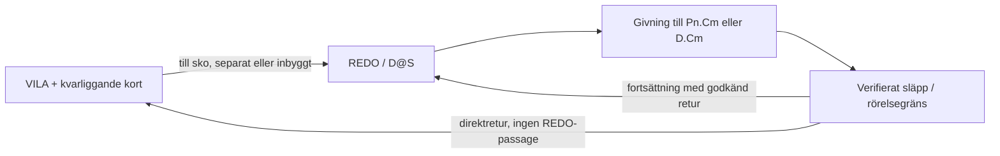

# Dealeridentiteter och pipelines

Identitetsgrunden kontrollerades 2026-11-08; Pamelas bank och systemkartan nedan kontrollerades 2026-11-10 av HUVUDAGENT-3 med tre avgränsade Astra-granskningar. Identiteterna bygger på Jakobs uttryckliga identifiering, separata projekt-/dealer-ID:n och filhashar. Utseende eller gemensamt lagringskonto identifierar inte en dealer.

| Lokal identitet | Scoutgaming-ID | Spår | Bevis |
|---|---|---|---|
| Göran · Scout Main | `goran` | Ordinarie filmade dealerklipp | Admin: `Göran · vila_andning_01 · 9492f43d`, klipp-ID `fbb08d0c-856c-52ca-a18b-1865866aa64f`. Lokal `goran_vila_grundloop.mp4` har samma hashprefix. Jakobs första bild identifierar dealern. |
| Blankurius · Scout Main | `blankurius` | Snabbstudion, enligt Jakob Utökad | Admin: `Blankurius · vila_andning_01 · 9fe76a9f`, klipp-ID `54c3ff6f-78ae-555e-8fdf-e7309c913d71`. |
| Göran · blackjack-studio | Inget verifierat | Separat experimentell Runway-pipeline | Jakobs andra bild och granskat Runway-original `893e4e04-f48f-4bf7-8e38-c416de50b033`. 1920 × 1080, 30 fps, 90 rutor, grön bakgrund. |
| Pamela · Dealerlab | Inget registrerat | `pamela-pilot`, egen V5-identitetsgrund och kalibrering | `references/dealers.json` samt de valda rå-/granskningsfilernas SHA-256. Alias `pamela` i äldre försöksplaner måste bindas explicit till samma identitet. |

`references/dealers.json` binder klassificering till exakt lokal SHA-256. Ändrade filer blir oklassificerade tills de granskats igen. Övriga Runway-filer tilldelas inte identitet bara för att de är nya eller har liknande promptnamn.

## Uppdaterad identitets- och provstatus

Registret `references/dealers.json` är kontrollerat mot sex historiska projektmanifest i `local-studio/blackjack-studio`, i både `typed-preview` och `creator`. De förblir en separat källa med egna identiteter. Inget av dessa verifierar en andra Pamela. Gemensam Pamela-identitetsgrund och återanvändning av kropp/kalibrering är därför okända. Projektet Naturbord · Liv har en deklarerad ankarkedja som inte stämmer med den valda bildens uppmätta hash; automatisk identitetskoppling är spärrad. Göran-projektets manifestrevisioner 103 och 107 hålls uttryckligen isär.

P1-piloten använder `pamela-pilot` / `snyggare-dealer` / `pamela-workspace-v1`. V2-kandidaten bevarar v1-tillgångarna. Varje kortmål behöver både direkt VILA och fortsättning via REDO, med kvarliggande bordskort. Aktuella fysiska prov finns via `references/pamela-physical-deal-review.json`; äldre returprov via `references/pamela-direct-return-review.json` och det äldre kortsidprovet via `references/pamela-card-side-review.json`. Inget av proven aktiverar en produktionsbank.
## Blankurius ursprung

Jakob uppger att Blankurius kom från `https://www.scoutgaming.tech/studio/snabb`, med utökat klippalternativ och en egen bild på vit bakgrund. Detta är **användaruppgift**, inte verifierad jobbproveniens. Jobb-ID, ursprungsbildens hash och eventuell omarbetning till keystonebild saknas ännu.

WebView bekräftade sidan och stegen Foto → Namn och röst → Omfattning → Kör → Granska → Sätt vid bord. Referenskoden `C:/Users/jakem/dev/scoutgaming/apps/studio/lib/snabb/client.mjs` använder `/admin-app/api/jobs/snabb` och kontraktets `grund`/`utokad`. Koden skiljer mellan en ny kedja och påfyllning av en klar Grund-dealer till Utökad. Det styrker att vägen finns, men avgör inte vilket jobb som skapade Blankurius.

En vit bakgrund är inte en kvalitetsstämpel. Keystonegranskningen behöver senare pröva identitet, kamera/perspektiv, händer och anatomi, ljus, silhuett och geometri mot målbilden. Ingen förbättring eller omarbetning har gjorts nu.

## Alternativa system

- **Äldre 3D-scenreferens:** Three.js-scen, panorama och videoplan från `extra/insperationsmall-alternativ`. Inte verifierad som riggad avatar. Se ALTERNATIV-3D.md.
- **Alternativ helkroppspipeline:** den större helkroppsfiguren i Jakobs andra bild. Samma projekt som den äldre 3D-scenreferensen är nu verifierat genom projekt-ID, ankare, panorama och nickfilm. 19 källfilmer finns i blackjack-studio revision 103. Koppling till Scoutgamings kortlogik är inte verifierad. Se `references/alternative-fullbody.json`.
- **Kevin/Emil:** separat referensgren och rörelsedata. Namnlikhet gör inte klipp, mått eller tidsaxlar utbytbara.

De alternativa referenserna ligger under studions tredje flik med separata källscheman. Ingen databaspost eller Blob-fil har flyttats eller ändrats. Gemensamt Blob-lager innebär inte i sig delad logik; någon fullständig granskning av produktionskopplingarna har inte utförts.

## GPT-underlaget

Paketets roll, innehåll och läsgränser finns i [studiokartan](KARTA.md#vad-gpt-mappen-är).

## Gemensamt filmkontrakt före Scout-integration

**Aktuellt kravunderlag 2026-11-10.** Filmval, nodkarta och QA utgår från samma V2-kandidat. Grunddemons 17 givningar omfattar två kort vardera till P1–P7 och tre till dealern. D.C4 är ett separat mål som används när motorn skickar ännu ett dealerdrag. Antal filmfiler följer återbruk och skarvbehov. Motorns giv-, hit-, double-, split-, dealer- och reveal-händelser styr vidare utökning.

Jakobs två ytterligare krav gäller genom hela planen: kortsidan ska kunna identifieras säkert, exempelvis med blå framsidesmarkör och gul baksidesmarkör; och **varje korts giv-/släppläge ska kunna gå direkt till VILA utan REDO/skobesök**, inte bara sista kortet i en fast runda. Öppen givning kräver belagd fysisk BACK→EDGE→FRONT-vändning. Författad sidväxling är historisk diagnostik, inte ersättning för fysisk rörelse. Dolt dealerkort har en separat giv-/revealprofil.

### En auktoritet, flera läsvyer

Använd `references/pamela-motion-contract-v2.json` och dess befintliga kärna som aktuell kandidatmodell med hashbundna delmanifest. V1-filen `references/pamela-motion-contract.json` är bevarad migrationsreferens, inte en parallell aktiv leveransrot. Bind original, valda bearbetningar, spår, masker, material, kalibrering och acceptans där. Nodkartan, biblioteket, granskningssidan och exporten blir härledda vyer. Befintliga original och försöksjournaler bevaras. En gemensam kontraktsmodell behöver inte vara en enda stor JSON-fil.

Jakobs nodträd är semantisk grund: fack, rörelser, poser och koordinatkonventioner. Originalstandarden säger själv att dess katalog är ett daterat Main-utdrag, inte runtimekonfiguration (`gpt-underlag/5/Scoutgaming-Pamela-standard-v0.1.md:5–13`). `references/schemes.json` är fem separata referensscheman, inte Pamelas körplan. Vid senare integration återanvänds Scouts `packages/presentation/contracts/engine-signals.json` och `.mjs`; skapa ingen ytterligare handskriven motoröversättning.

### Vad som redan finns och vad som saknas

| Del | Verifierat 2026-11-10 | Kvar till den beställda banken |
|---|---|---|
| P1–P7, C1/C2 | 14 råfilmer och 14 valda granskningsfilmer; 28/28 SHA matchar. Kandidaterna är 360 rutor, 1762×1174, 30 fps. | Gemensam layout, stabilt tryck, full kontakt-/skarvacceptans och styrbar kortstate. |
| D.C1–D.C4 | Alla fyra dealerplaceringar är obundna i V2 r3. | Öppen givning, separat dold D.C2-givning och fysisk reveal av samma kort. D.C3 och D.C4 följer motorns extradrag. |
| VILA och sko | Tre viloklipp och två bryggor i äldre kontrakt; senare separat VILA-kedja finns. | Bind senaste resultat, acceptera faktiska skarvar och behåll bordskorten under retur. |
| Direkt giv → VILA | Fysisk P1.C1-retur är bunden och lokalt rörelsegranskad. Äldre returförsök har separata granskningskvitton. | Direkt VILA och alternativ via REDO från varje mål. Kvarliggande kort, skarvar och lager kräver egna kontroller. |
| Kontrakt | V2 `candidate-20261110-v2-r3` beskriver 27 tillgångar, 74 rörelser och 18 kortmål inklusive D.C4. | Bind film och kvalitetsbevis för varje saknad väg. |
| Nodkarta och DL1 | Det aktuella manifestet har 56 krav, varav 40 saknar bunden källfilm. Där ingår 18 givningar, 18 direktreturer, 18 REDO-returer, REDO→VILA och en fysisk REVEAL. Den äldre grafen med 205/281 hör till historiken. | Visa hela rörelsegrafen inklusive ankare, varianter och obundna utgångar. |

**Kandidattäckning för de 17 givmålen: 14/17 = 82,4 %.** Detta räknar kandidatfilm per mål, inte direktreturer, reveals, kvalitet eller total projektfärdiggrad. Produktionsacceptans för den valda banken är 0 %. Den fasta 4 319-rutorskedjan visar en hel rundas retur med 14 kort, inte valfri retur efter N.

Källor: `references/pamela-motion-contract.json:299–317,426–789,876`, `references/pamela-two-sided-bank.json:3–8`, `references/pamela-idle-chain-review.json:3–12`; bankens `runs/20261110-pamela-mask-bank/take-01/evidence.json` har SHA `ed63d72517802affc241445070c3242c5440d0ab2122d6f55a36b22f372967dc`. Kedjans film har SHA `9b9f9d84e75ff537e4dadae6ded9755fce38b4aa973f20e76ce32336d02d8dcf` och eget bildplan 1764×1174/30 fps. Ingen ny total mognadsprocent har mätts; externa granskarens cirka 35 % är en osäker skattning på äldre versioner.

### Namn, kortplatser och koordinater

[Namn och rörelsesträngar](NAMN-OCH-RORELSESTRANGAR.md) är norm för nya etiketter: C är primärt och K endast schemaidentifierat alias. Dealerhandens L/R/BOTH/UNKNOWN är separat från spelarhandens `handId`/`layoutHandId`. REDO och REVEAL skrivs fullt; ett ensamt R får inte blanda pose, handling och höger hand. Befintliga original-ID:n och hashbundna V2-kontrakt behålls tills en uttrycklig adapter finns.

| Läsbar etikett | Betydelse och strukturerade data |
|---|---|
| `P1.C2` | Spelarplats 1, kort 2 i den aktuella handen. V2:s `P1.K2` och äldre `C2-P1` kräver varsitt identifierat källschema; byt inte namn på original. |
| `P1.C1` med separat hand-/grenbindning | Första kortet i en bestämd spelhand. Split anges med motorns hand-ID och layoutbindning, inte genom att blanda dealerhand och kortordinal. |
| `D.C1`–`D.C4` | D.C1 är öppet, D.C2 ges dolt och vänds senare på samma kortinstans. D.C3 och D.C4 är öppna extradrag som kräver motorhändelser. |
| `S` | Sko som rekvisita/kontaktpunkt, inte spelarplats. |
| `D@S` / eventuellt `DS` | Läsbar poseetikett för dealer vid sko. Den motsvarar REDO först när hand-/kroppsposen verifierats. |

Plats P1–P7 motsvarar Scout `box0`–`box6`. Kortordinal i handen, rörelsevariantens nummer och motorns `shoeDraw` är olika axlar. `shoeDraw` och kortinstansens identitet följer kortet även när split ändrar handen. **K5 saknar fast definition i de granskade originaldokumenten.** Jakobs exempel specificeras därför som direktretur från en identifierad giv-/släppändpunkt med mottagare, kortinstans och källruta; det tolkas inte automatiskt som plats P5 eller ett femte handkort.

Varje landning får en gemensamt vald bordslayout och egen källkalibrering: koordinatrum, pixelmått, origo, axelriktning, enhet, fyra ordnade kortlokala hörn, UV-riktning, vinkelkonvention och transform till scen/export. Centrum och vinkel räcker inte vid perspektiv eller böjning. Spår anges per källruta/presenterad tid med synliga/ockluderade hörn och hand-/sko-/bordsmasker. 1762- och 1764-planen, 1536×1024-ankare och Scouts 1080×1920/24 fps får inte blandas; varje omkodning/transform har egen hash och tidsmappning. Gula punkter i gamla nodkartan är uppskattningar, inte mätta kortspår.

### När filmerna ska spelas

Detta är målkontraktet. Filmväljarens enda spelfakta kommer från motorn; bankens kontrakt avgör vilka presentationsrörelser som faktiskt kan utföras.

| Situation | Film-/rörelseval och kvarvarande krav |
|---|---|
| Väntan | Accepterad VILA-loop med separata blink-/blickinstick; bordskort ligger kvar. `idle.ready` är facknamn, inte fysisk REDO. |
| Första giv från VILA | Egen `i/iv`-giv eller separat till-sko följd av en giv som börjar REDO. Skorörelsen spelas bara en gång. |
| Flera redan beslutade givningar | Uttag → handtransport → släpp/landning → validerad återgång inför nästa giv. Varje kortinstans läggs till exakt en gång. |
| Sista giv / stopp efter N | Verifierad giv-/släppändpunkt → direkt VILA, eller hel `v/iv`-tagning som gör samma väg. Inget automatiskt REDO-mellansteg. |
| Nästa händelse kommer under retur | Slutför en säker rörelsegräns, bevara kortstate och starta nästa godkända väg. Klipp inte av en hand mitt i greppet. |
| Dealer | Scout ger aktiva platser från P7 mot P1, sedan D.C1 öppet, sedan samma spelarriktning igen och D.C2 dolt. Motorns reveal vänder samma D.C2 före eventuella D.C3/D.C4. |
| Senare hit/double/split | Samma platsmål kan användas i Scout, men rätt hand, fler kort, överlapp och rörelsekapacitet måste vara uttryckligt stödda. Tvåkortskällan blir ingen automatisk reserv. |
| Tur, försäkring, tal/resultat | Scout-signaler och replikval; video/ljudägarskap och tidsbas ska anges. Saknad Pamela-film markeras saknad eller får en uttrycklig godkänd reserv. |
| Återställning för ny runda | Egen motorstyrd händelse och presentationsväg. Att gå till VILA får aldrig i sig rensa bordet. |



Diagrammets grenar kräver verkliga filmer och godkända anslutningar. Den äldre v1-kärnan `src/pamela-motion-contract.ts:7,93–95` har bara VILA/REDO och kräver REDO→REDO för alla `deal`. V2-kandidaten och `src/dealer-motion-contract.ts` kan beskriva giv-/släppgränser och direktretur med oberoende kortstate, men ger inte filmerna acceptans. Ett `endPose=VILA` eller suffix `v/iv` bevisar inte vilken väg handen tog.

### Keystones och smart klippning

1. **Identitetsbilden** låser Pamelas utseende. **Poseankare** låser VILA, REDO och vid behov en faktisk släpp-/returpunkt i samma kamera, kroppsskala, bord och sko. En stillbild bevisar aldrig rörelsen mellan ankaren.
2. Sök först i befintliga filmer efter heltalsrutor efter släpp men före återkomst till skon. Jämför pose, handens riktning/hastighet, ansikte, ljus, kontakt och kvarliggande kort mot en möjlig retur. Granska även angränsande rutor; likhet i en enda ruta räcker inte.
3. Välj den kortaste **accepterade** vägen med få skarvar. Bevara verklig rörelsehastighet, fps, bildrutemappning och motorordning. Skarvkrav väger tyngre än klipplängd; frysning, omvänd film eller övertoning blir inte bevis för korrekt direktretur.
4. Saknas rätt rörelse, beställ en liten avgränsad direktretur eller hel sista-giv-variant via Runway API. Första/sista bild används bara om vald modell stöder det, med exakt planerad indata och QA. Antal nya filmer bestäms av konstaterade rörelseluckor, inte en multiplikation av alla nodpar.
5. Spara exakta gränspar: föregående SHA/slutruta → nästa SHA/startruta, beslut och bevis. Ett gemensamt REDO-ankare kan senare minska antalet parprov, men bara genom verifierade toleranser för hela rörelsegränsen. Kroppsklippet får aldrig äga eller nollställa bordets kortlista.

Normal `base` är REDO→giv→REDO, `i` VILA→giv→REDO, `v` REDO→giv→VILA och `iv` VILA→giv→VILA. Dealer-hole/flip har undantag. Kevin-staging beskriver egna direktavslutande v/iv-tagningar, medan Main även kan binda en påhängd retur under sådana namn. V2 registrerar `returnMode=direct | via-redo | to-redo | none` som ett krav på den faktiska filmvägen. Se `gpt-underlag/5/Scoutgaming_dealerbank_nodtrad_koordinater_2026-11-09.md:286–302`, Kevin-staging `kevin/croupier-scoutgg/server/shared-table.mjs:98–101` och Main `packages/presentation/contracts/filmed-profiles/studio-profile.mjs:27–38` på respektive revision nedan.

### Blå/gul rekvisita och kortdesign ovanpå

Blå=framsida och knallgul=baksida är en **föreslagen inspelnings-/genereringskonvention**. Färgerna ska finnas i källfilmen om de ska ge oberoende sidbevis. Två färger skiljer sidor men ger inte automatiskt kortets överkant, UV-riktning eller dolda hörn. Kantläge, handskymning och blur kan fortfarande ge EDGE/UNKNOWN. Ett hashbundet sidspår anger observation, metod, synlighet och eventuell författad korrigering.

Befintlig React/Next-vy använder direkt Three.js, inte ett verifierat React Three Fiber-flöde. Den har redan separata front-/backtexturer, UV, kortmask och handskydd (`src/pamela-combined-stage-client.tsx:55–83,116`, `src/pamela-two-sided-card.ts:8–14,29–63`). En blå/gul diagnostisk overlay kan granskas med befintligt blankt material, men visar då den **författade sidpolicyn**, inte en uppmätt fysisk sida. Originalets `physicalSide:UNKNOWN` ändras inte genom den färgläggningen.

En verklig blå/gul källa kräver anpassade masker och neutralisering av källfärgen. Dagens ljusa pappers-/RGB-regler och belysningsmodell kan inte förutsättas fungera på mättad rekvisita (`src/pamela-paper-coverage.ts:2–20`, `src/pamela-card-atlas.ts:35–36`). Prova först ett korts hela utdragning, kantpassage, grepp/släpp och landning mot två slutdesigner. Under greppet ligger händer/fingrar framför trycket. Fysisk sida, slutmaterial och motorns rätt att visa kortidentitet är separata fält; saknad eller nekad reveal får inte visa valör.

### Beställning, körjournal och acceptans

| Kontraktsdel | Minimikrav |
|---|---|
| Identitet och källa | Projekt, canonical dealer-ID, bank/revision, original-SHA, käll-/leveransmått, fps/tidsbas och intervall. Pamela och de två Göran-projekten har separata profiler. |
| Rörelse och kortstate | Mottagare, hand-ID, kortordinal, cardInstanceId/shoeDraw, acquire/release/settled-cues, källans inbakade kort, gränsposer och direktreturpolicy. |
| Geometri och lager | Scen-/bord-/sko-/kameraprofil, kortspår, sidspår, masker, UV, material och explicita transform-/tidsmappningar med hash. |
| Beställning/journal | Modell och verifierat stöd, antal jobb, kostnadstak, prompt/ankare, input-/kodhash, stegstatus, sparat provider-task-ID och utdata. Okänd submission ska utredas innan nytt jobb skickas. |
| Acceptans | Separata beslut för filintegritet, kontakt, tryck, state, skarv, export och senare integration. Ny rörelsehash ogiltigförklarar berörd spår-/mask-/QA-bindning. Materialbyte bygger om render/QA/export utan att automatiskt generera ny rörelse. |

Den tidigare pilotsviten omfattade tolv avslutade WAN3-jobb. Fem returer kostade 300 krediter, fyra fysiska givningsprov kostade 400 och tre övergångar kostade 120, totalt 820 krediter. Planer, original, task-ID och terminalkostnader är bevarade. Kostnaden för den avvisade imagegen-referensen är okänd och ligger utanför mätningen.

P1.C2-planen `p1-c2-samehand-01` kontrollerades lokalt. Efter godkännande av de två specifika bilderna och prompten skickades ett fyra sekunder långt WAN3-jobb via Runway Dev API. Task-ID sparades och 80 krediter rapporterades vid inskickningen. Formatkontrollen verifierade 120 originalrutor i 1764×1174 vid 30 fps. Visuell QA avgör om det nya provet går att använda. [Plan](../../runs/20261110-pamela-goal-pilot/p1-c2-samehand-01/plan.json) · [Jobbstatus](../../runs/20261110-pamela-goal-pilot/p1-c2-samehand-01/state.json) · [Formatkontroll](../../runs/20261110-pamela-goal-pilot/p1-c2-samehand-01/native-verification.json)

Den nya C1-rörelsen är lokalt accepterad: BACK→EDGE f47–48→FRONT f49, sista kontakt f94 och fri hand f95. Den klipps före extra handsänkning. Hela VILA→P1.C1→VILA består av entry0–58 + giv0–102 + retur0–59 =222 rutor/7,4s; alla avkodade rutor matchar sina råkällor. En liten oförändrad fingerdetaljskillnad finns i skoövergången. Ny C1→sko-brygga:60 rutor, tom hand och ett kvarvarande kort. Båda C2-proven är underkända: första byter bred gul f50→bred blå f51 utan kantpassage; andra byter f66→f67 och visar därefter fel vit/tryckt kortyta under extra vändningar. Kortspår, masker och produktionsacceptans återstår.

Grundgivningar:1/17 med lokalt godkänd rörelse,16/17=94,1% återstår. Hela paketet inklusive övergångar, lager och varianter:80–90% återstår, uttrycklig skattning utan tidsprognos. Historiska14/17 är kandidattäckning och räknas inte som godkänd ny bank.

Samma handling, mål, start-/slutankare och kortföre/efter. Varje film anger hand och egen QA. Avsiktlig kortjustering har särskild kontaktklass och källrutor; den får aldrig bli en ny givning eller blandas med vanlig retur utan återkontakt. Blick och andra gester får variera inom samma godkända gränser. Befintlig DL1 består av tio fält inklusive ref; variantmetadata ligger strukturerat på Motion och skapar ingen konkurrerande strängstandard.

**Den historiska returpiloten hade 0/2 accepterade returer.** De äldre B-proven passerar inte REDO efter sista släppet, men B252/B326/B359 matchar inte ursprunglig VILA-keystone. Canonical C1 take01 återkontaktar kortet i råreturens rutor 5–13. Take02 börjar i C1-källruta 210 med tydligt lyft hand men återkontaktar i råretur 12–18, motsvarande proof 223–229 / 7,433–7,633 s. Slutposen nås, medan textur-/handformsskarven till märkt stillhold är underkänd. Returpilotens proof har 331 rutor/11,033333 s/30 fps och SHA-256 `6028923533a67551e9705abe77b37552bfecd635d225a4c32a24ad64b7123f5c`. [Material och status](../MASTERPLAN.md#verifierad-p1-pilot-och-gemensamt-kontrakt-2026-11-10)

### Scout-källor och senare anslutning

Scout-källorna lästes i `C:/Users/jakem/dev/scoutgaming`. Givningslogiken i `main` på `37165b57a3076a0ea3d16626c7e4f2e06a793dd7` och medie-/logikreferensen `kevin-staging` på `61612e8f4d9d6ca66b9d57b90a47fc76f7c4cb65` matchade GitHub den 10 november. Kontrollera grenrevision igen inför en faktisk integration.

| Kedjelänk | Befintlig roll och exakt källingång |
|---|---|
| Beställning → jobb | Studio → Ny dealer; `packages/studio-registry/server/snabb-chain.mjs:1–14,37–54` har plan → portratt → dealer → klippkarta → import med beständig steg-/jobbidentitet. |
| Jobb → material | `services/studio-worker/kinds/snabb.mjs:308–327,372–424`, `pipelines/snabblage/` och Dealer Factory skapar/exporterar material. Dealer Forge är ett separat spår; kopiera inte dess körjournal ovanpå snabbkedjan. |
| Motor → fack | `packages/presentation/contracts/engine-signals.json:62–175`: motorhändelse → katalog/situation → mål. Spelarkort 1/2/3+ använder samma platsmål; dealer-up/hole/flip är skilda. |
| Fack → vald film | `packages/presentation/contracts/filmed-bank-bindings.mjs:18–43,74–101`, `services/game/presentation/filmed-deal-selection.mjs:12–34`: dealer, profil, video-ID, exakta SHA och sparad bindning. |
| Film → uppspelning | `packages/presentation/runtime/filmed-deal-sequence.mjs:55–95` väljer posevariant; `services/game/public/filmed-action-controls.mjs:16–34,46–67` kopplar presenterad bildtid till kortspår/landning. |
| Kevin/Emils Git-grenar | `kevin` och `kevin-staging` är grenar i GitHub-repot Scoutgaming; `kevin/croupier-scoutgg/` är en paketväg inom grenarna. `public/game-events.js:28–56` planerar giv/reveal från snapshots och shoeDraw. Staging har andra viloval och lagerklocka. `kevin/README.md` beskriver Emils Astrid-demo och GitLab-källrevision; det bevisar inte upphovet för varje film. |

Den tidigare kartläggningen jämförde bland annat main `66ccd80c053694fcc0173cec294cc2277962dd0c` och `b6d5f74fa659339e3d1ae6da42257623a2ad351e` med kevin `d96c6eb0e8588e50efdb7640dec1a16dd042579c` och kevin-staging `61612e8f4d9d6ca66b9d57b90a47fc76f7c4cb65`. Astrid2-profilen är fryst från `99d6447b76d1bf472bb1e92663e13f375f27ce03`. I den kartläggningen hade Main 35 registrerade tagningar per fryst standardbank. De granskade Astrid2-, PAOW- och Dragge-v2-träden hade 56/90/85 MP4 och var byteidentiska mellan Kevin-grenarna. Siffrorna gäller dessa urval.

Två senare integrationsgrindar är konkreta: `packages/presentation/contracts/filmed-profiles/studio-profile.mjs:4–16,78–84` låser befintlig measured-profil till 1080×1920/24 fps utan egna tracks; Pamela behöver en sanningsenlig egen bank/profil eller utvidgad import. `services/studio-worker/pipelines/snabblage/lib/dealer.mjs:394,515` har fortfarande en statiskt verifierad återförsökslucka för referensbild i `unknown` utan task-ID. Ingen faktisk dubbeldebitering är belagd. Dessa frågor hindrar framtida integration/automation, men flyttar inte dagens videoprioritet till Scout-kodändringar.

### Från dealerbeskrivning till granskningsbar Scout-export

1. **Skriv beställningen.** Ange projekt, dealer-ID och bankrevision, personens utseende, kläder, bord och sko, rum, ljus och kortstil. Välj vilka motorhändelser och poser materialet ska täcka. Jämför fack och mediekedja med verifierad `kevin-staging`. Återbruka Scouts gemensamma kortfront i hand och på bord som princip, samt plats-ID:n och layoutindata för presentationen. Ny fysisk landning mäts i den nya scenen. Dealerlabs chipstudie ger återanvändbar geometri, tryck och ljusprofil för ett studioprov. [Pipelinekarta](../../references/pipeline-map.json) · [Kortgrafik](https://github.com/Jakeminator123/scoutgaming/blob/37165b57a3076a0ea3d16626c7e4f2e06a793dd7/services/game/public/card-art.mjs) · [Bordslayout](https://github.com/Jakeminator123/scoutgaming/blob/37165b57a3076a0ea3d16626c7e4f2e06a793dd7/services/game/public/shared-room-layout.mjs) · [Chipstudie](../../src/chip-material-study.ts)
2. **Frys scenen och planera VILA och REDO.** Välj en fast scenbild med bord, sko, kamera och ljus. Pamelas valda `jade-neutral-emerald-v1` är ett befintligt jämförelseprov. Ange friformsbeskrivningen och `projectId`, `dealerId`, `bankId` i en lokal specifikation. Verktyget skriver en plan för en bild i Gen‑4 Image, 1920×1080. VILA har taggade scen- och posereferenser och etablerar kandidatens identitet. REDO kräver dessutom den godkända VILA-bilden från samma beskrivning, projekt, dealer, bank och scen. Scout-workern använder också separata pose- och identitetsbilder och sparar task-ID för sitt bildjobb. [Pamelas bakgrundsprov](../../references/pamela-background-review.json) · [Bildplaneraren](../../tools/dealer-reference-plan.ts) · [Runway API](https://docs.dev.runwayml.com/api/) · [Scout-workerns bildmetod](https://github.com/Jakeminator123/scoutgaming/blob/35b181c556bd54b6a50268cdfb4189990773aef5/services/studio-worker/dealer-factory/dealer_factory/runway_dev.py#L116-L130) · [Scouts bildjournal](https://github.com/Jakeminator123/scoutgaming/blob/35b181c556bd54b6a50268cdfb4189990773aef5/services/studio-worker/dealer-factory/dealer_factory/pipeline.py#L235-L253)

   Spara en specifikation med `schemaVersion: 1`, `role: "VILA"`, `description`, de tre ID:na, `scene: { id, reference }` och `poseGuide`. Varje filreferens innehåller lokal `path` och `sha256` med gemener. Posereferensen pekar på ett JSON-underlag med `schemaVersion: 1`, `kind: "dealer-pose-guide"`, rätt `role` och `image` som pekar på stillbilden. Kör från projektroten i en ny run-mapp.

   ```powershell
   $spec = 'runs/min-dealer/vila-spec.json'
   $sha = (Get-FileHash -LiteralPath $spec -Algorithm SHA256).Hash.ToLowerInvariant()
   volta run --node 24.21.0 node tools/dealer-reference-plan.ts plan "--spec=$spec" "--sha=$sha" "--out=runs/min-dealer/vila-plan.json"
   ```

   **Kör en bildplan.** Kontrollera planen med `check`. Efter uttryckligt godkännande av prompten och bildfilerna sparar operatören ett eget JSON-godkännande under `runs/`. Det har `schemaVersion: 1`, `kind: "dealer-reference-image-authorization"`, `plan: { path, sha256 }`, `approvedBy`, `maximumPostAttempts: 1`, `maximumCredits: 8` och `mediaTransferAuthorized: true`. Godkännandet binds till planens exakta sökväg och SHA-256. Listpriset för Gen‑4 Image i 1080p är 8 krediter per bild. [Bildjobbsverktyget](../../tools/dealer-reference-job.ts) · [Prisreferens](https://docs.dev.runwayml.com/guides/pricing/#image-generation-pricing)

   ```powershell
   $plan = 'runs/min-dealer/vila-plan.json'
   $planSha = (Get-FileHash -LiteralPath $plan -Algorithm SHA256).Hash.ToLowerInvariant()
   volta run --node 24.21.0 node tools/dealer-reference-job.ts check "--plan=$plan" "--sha=$planSha"
   $approval = 'runs/min-dealer/vila-authorization.json'
   $approvalSha = (Get-FileHash -LiteralPath $approval -Algorithm SHA256).Hash.ToLowerInvariant()
   volta run --node 24.21.0 node tools/dealer-reference-job.ts submit "--plan=$plan" "--sha=$planSha" "--authorization=$approval" "--authorization-sha=$approvalSha"
   volta run --node 24.21.0 node tools/dealer-reference-job.ts status "--plan=$plan" "--sha=$planSha"
   volta run --node 24.21.0 node tools/dealer-reference-job.ts download "--plan=$plan" "--sha=$planSha"
   ```

   `submit` journalför försöket före ett enda `POST /v1/text_to_image` och sparar task-ID i `runs/dealer-reference-jobs/<plan-sha>/`. Samma planhash kan skickas en gång även om planfilen kopieras. Vid okänt utfall spärras nytt inskick medan Runway-uppgiften utreds. `status` läser taskstatus. När jobbet lyckas hämtar `download` de oförändrade bildbyten till `download/` och lämnar MIME, mått och SHA-256 i kvittot. Person, handpose, kamera, sko och bord väntar på visuell QA. Nätverksflödet är verifierat med simulerade svar. Liveprov och kalibrering av ny person återstår. [Lokalt röktest](../../runs/20261110-dealer-reference-job-smoke-01/receipt.json) · [Runways svar och originalfiler](https://docs.dev.runwayml.com/assets/outputs/)

   När VILA-bilden är visuellt godkänd av en namngiven granskare skapar ni en granskning med `schemaVersion: 1`, `kind: "dealer-reference-anchor-review"`, `role: "VILA"`, `status: "approved"`, `reviewedBy`, `vilaPlan` och `image`. REDO-specifikationen byter till `role: "REDO"` och sin egen poseguide och pekar på granskningsfilen i `identityAnchor`. Kör samma plan- och jobbflöde med den nya planen och ett eget godkännande.
3. **Planera minsta saknade filmprov.** Återanvänd hashmatchande godkända rutor först. Kontrollera därefter en lokal plan med `node tools/dealer-video-job.ts check --plan=<fil> --sha=<sha256>`. Lås modellstöd, antal jobb, prompt, eventuella första/sista bilder, förväntat format och kredittak. Skicka den kontrollerade planen med `submit` via Runway Dev API efter godkännande av det exakta underlaget. Spara task-ID och följ det med `status`, som också hämtar och verifierar originalformatet när jobbet lyckas. Utred okänt inskick före ett nytt försök. Samma underlag och journal ska gå att kontrollera igen utan ett nytt betalt jobb. [Jobbverktyg](../../tools/dealer-video-job.ts)
4. **Granska rörelsen och sätt ihop filmen.** Bind öppna givningar till fysisk BACK→EDGE→FRONT, dold D.C2 till BACK→BACK och senare REVEAL till samma kortinstans på motorhändelsen. Bevara användbara BACK→BACK- och FRONT→FRONT-tagningar med egen proveniens. Granska grepp, släpp, landningsvinkel, korttryck, handmask, kontakt och samtliga skarvar. Prova direkt VILA och separat REDO med tidigare kort kvar. `tools/pamela-film-route.ts` planerar symboliska vägar och kan sammanfoga intervall med explicit QA. Det befintliga P1.C1-kvittot verifierar 222 avkodade rutor vid 30 fps, sammanlagt 7,4 s, i råkedjan VILA→giv→VILA. Filmkvittot gäller denna väg. [Filmverktyg](../../tools/pamela-film-route.ts) · [P1.C1-kvitto](../../runs/20261110-pamela-film-route/take-01/receipt.json) · [V2](../../references/pamela-motion-contract-v2.json) · [DL1](../../references/pamela-motion-labels-review.json)
5. **Förbered senare Scout-export.** Exportera godkända klipp, material, masker, positionsspår, tidsmappning och QA med exakta källhashar. Mappa händelser via Scouts befintliga signaler och verifiera en kompatibel uppspelningsprofil för klippens faktiska format. Scout äger sko, kortidentitet, synlighet och utfall. Studioprovet blir ett produktionspaket först efter separat profil-, import- och uppspelningsacceptans.

Äldre problemfönster att jämföra är C1-P1 170–185, C2-P1 83–120 och kedjeskarv 513→514. Externa förslag om ≤1 px RMS, ≤2 px tryckhopp och ≤3 px landningsfel är ännu oprövade toleranser i ett fast koordinatplan.

Bevara original och unika QA-bevis. Registrera avställda filer i det befintliga hasharkivet. Kör `copy`, verifiera SHA-256 och en återställning via `restore`, och kör sedan `prune` endast för oförändrade källor med klarlagda ägare och läsare. [Arkivregister](../../references/storage-archives.json) · [Arkivverktyg](../../scripts/archive-work-material.ts) · [Arbetsmaterial](../drift/PROVISORISK-STRUKTUR.md)

